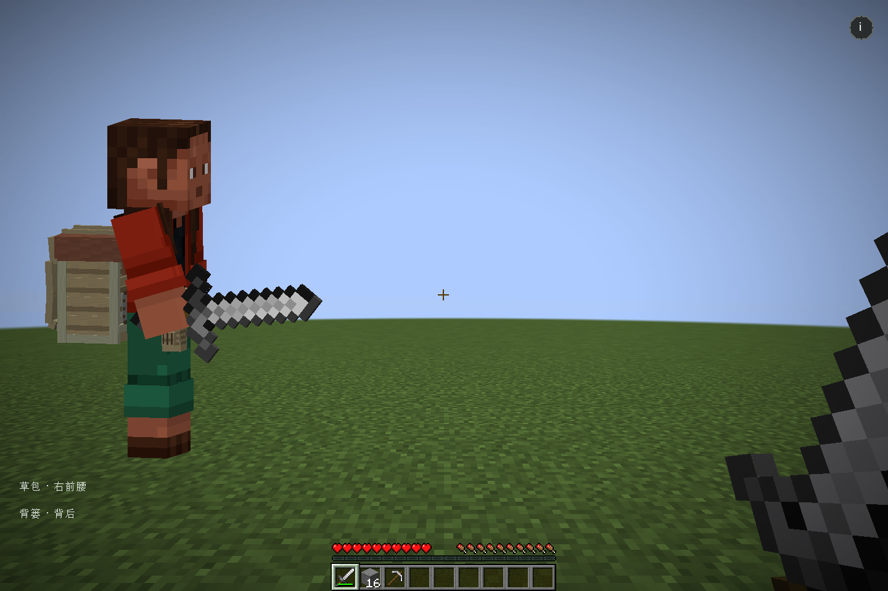
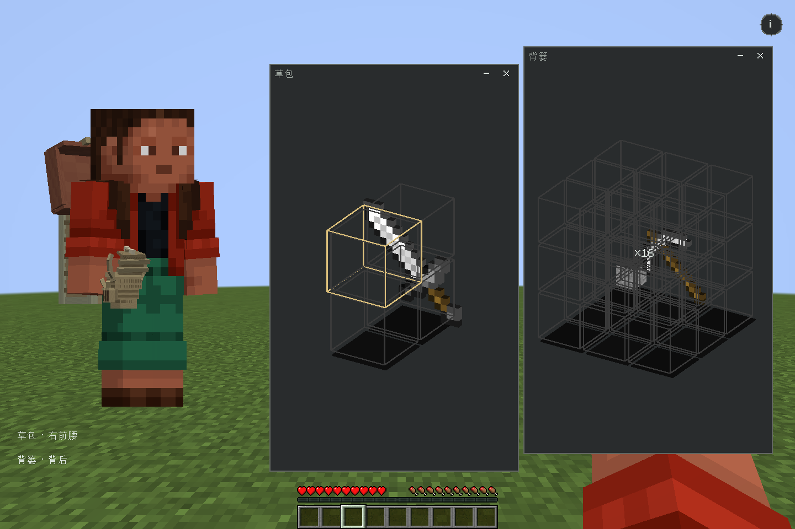
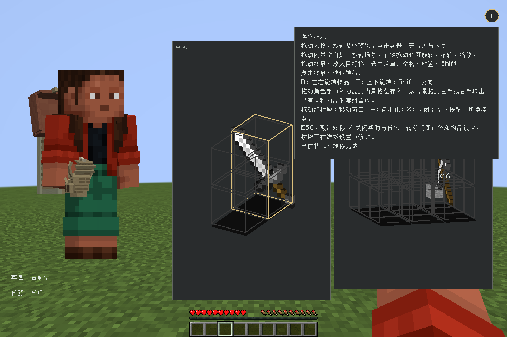
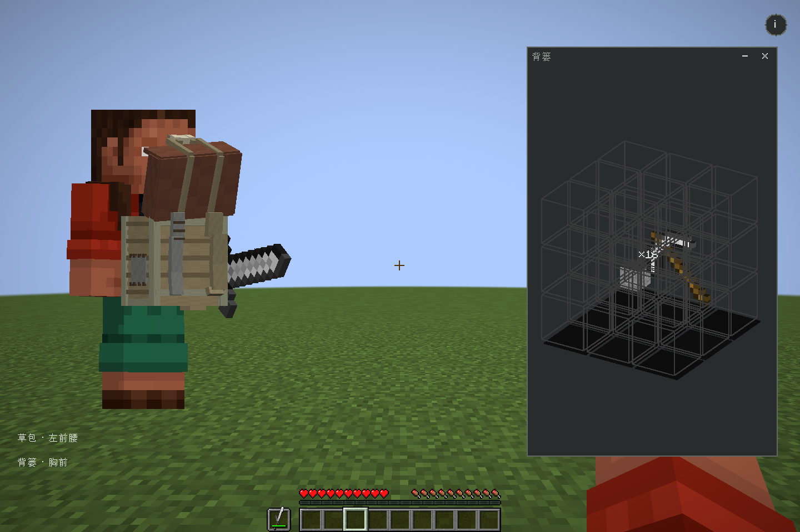
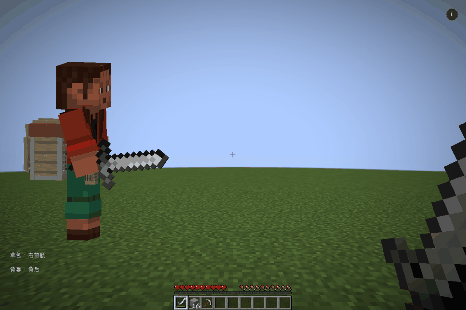

# Backpack and Storage 3D

基于 Inventory UI Framework 的三维背包扩展。腰挂容器挂在角色腰侧，背篓、背架和胸挂装备在躯干前后；指向模型高亮边缘，点击打开盖子，再进入可旋转的三维内景。页面背景透明、人物取景固定，操作说明通过右上角圆形 **i** 按需展开。

- 自带九件 [Bong 收纳装备](docs/wiki/Bong-Gear.md)：骨架背篓、锈框背架、杂皮行囊、皮囊胸挂，以及灵草囊、矿石袋、水囊、防潮包和骨币匣；内部容量、外部占格（宽 × 高 × 深）与挂点见该页。模型与贴图随模组分发，创造模式在专属的「背包与收纳」物品栏。早期的草包、背篓、收纳箱已于 2026-11-01 移除。
- 内景使用真实 ItemStack 的三维模型，支持方块、工具及其他模组提供的物品模型。
- 多个轻量内景窗口可同时打开、拖动、最小化；窗口主体只有 3D 内景，物品可跨窗口、双手、盔甲和容器拖放。
- 内景上方双滑块范围条控制最低和最高可见层，至少保留一层，便于向中间层放置；已占用格合并高亮外轮廓，相邻格之间不画内部亮线。
- 人物和容器一起拖动旋转；内景空白处左拖或右拖旋转场景，拖动物品可跨容器转移。背包界面内 R 左右旋转物品、T 上下旋转，Shift 反向；旋转键在 bs3d 配置中修改，见[操作说明](docs/wiki/Interaction.md)。
- 腰挂容器可沿腰环连续拖动，默认最多 2 件；胸背容器装备在它允许的胸前或背后。容器作为真实物品携带内容，也可收纳进其他容器。
- 装备外观也显示在游戏世界中的玩家身上：F5 第三人称和附近其他玩家可见，随躯干动作与环境光变化。
- 手持容器 **Shift＋右键** 放到有支撑的地面并播放放置音效；右键地面模型打开内景，空手 **Shift＋右键** 收回整包，身份和内容保留。
- 转移由服务器在同一 tick 内校验、提交和回执；失败保留来源。Shift 双向快捷搬运，拖到合盖容器模型自动寻位。
- 容器开合音效与物品材质音效分开播放；数据包可用原版 item tag 配置完成音效和占用尺寸。
- `config/bs3d/config.toml` 按固定格式登记 `.bbmodel`，可选开合动画和开启、关闭、放置、收回、触碰 OGG 音效；未登记模型跳过并警告，F3+T 重载。
- 附属模组可在 `fabric.mod.json` 中声明 protobuf 物品清单（或调用 `ItemRegistrations`），启动时注册普通物品与容器，规则与 TOML 一致；容器可随 JAR 自带 `.bbmodel`、动画与音效。
- 真实物品与原版背包原子保存于同一玩家存档，客户端不能提交 NBT 创建物品。

当前为 **0.1.0-SNAPSHOT，未发布正式版本，API 尚未冻结**。目标环境为 Java 25、Minecraft 26.2、Fabric，支持单机内置服务器和专用服务器。新玩家通过物品获得容器。旧存档里已移除的草包、背篓、收纳箱按损坏容器原样保留：记日志、不能打开或取出，见[通信和持久化](docs/wiki/Protocol.md)。业务协议 **v7** 要求客户端和服务端同步升级，玩家保存格式为 3（不再读取格式 1、2），地面库存格式为 1。地面背包允许附近玩家依次使用，同一个包一次只接受一位玩家操作；库存、转移校验和持久化均由逻辑服务器负责。

## 效果预览

下方为此前版本的真实 Fabric 客户端截图，展示装备与内景窗口；画面中的草包、背篓已于 2026-11-01 移除，盔甲拖放、容器收纳和 Bong 装备尚未重新录制演示。







动图由自动验收过程录制，包含脚本主动发起的转移；正常打开容器只播放开盖动画（没有开合动画的模型直接打开内景），不自动存取物品。按键、装备挂点与取消语义见[操作说明](docs/wiki/Interaction.md)。

## 构建与安装

先准备同级的 Inventory UI Framework 与 Kizuna-Meridian-Mod-Framework 源码（后者提供工作区脚本与版本目录），再执行：

```sh
./gradlew -Dorg.gradle.java.home="/path/to/jdk25" test build
python3 scripts/wiki.py check
```

Inventory UI Framework 以组合构建接入，随本仓构建先行编译；不在同级目录时加 `-Pkizuna.dir.inventory-ui="/path/to/Kizuna-Inventory-UI-Framework"`。Gradle 须在 Java 25 上运行，产物以 Java 25 为目标（Minecraft 26.2 的要求）。

客户端安装 Framework client/server、Fabric API、owo 与 BS3D client/server 两个 JAR；专用服务器只安装 Framework server、Fabric API 和 BS3D server。具体产物及单机装配见[安装与构建](docs/wiki/Getting-Started.md)。

默认按 **B** 打开。从角色模型的左手或右手拖动物品到容器内景存入，反向拖到手掌即可取出；双手互拖、盔甲穿脱和容器装备也由拖放完成。支持惯用手设置；目标手仅在为空或能完整叠放同种物品时接收。新玩家可从创造模式「背包与收纳」物品栏获取容器，或由管理员用 `/give` 发放。

## 接入与扩展文档

文档唯一编辑来源为 [docs/wiki/Home.md](docs/wiki/Home.md)，包括操作、协议、数据包扩展和验证记录。公开 API 和通信类型以当前源码及 `shared/src/main/proto/volume.proto` 为准。

自带容器的 `.bbmodel` 随 JAR 分发；客户端不生成默认配置或模板模型，玩家可在 `config/bs3d/config.toml` 登记自己的 `.bbmodel` 覆盖或补充，运行时只加载白名单中的模型；完整格式和支持范围见[模型、动画与音效导入](docs/wiki/Model-Resources.md)。

MIT License。
